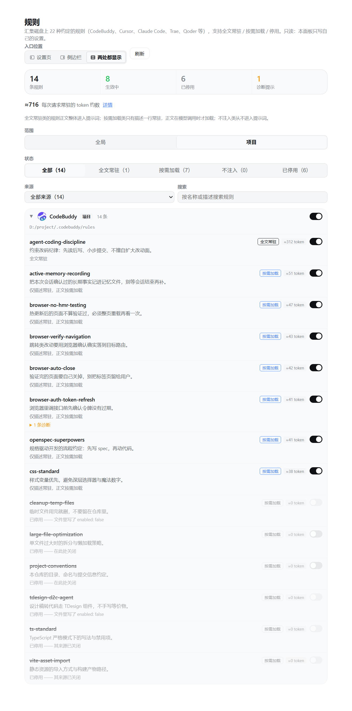

# dsh-rules-manager

> Load and manage cross-agent rule files in [DeepSeek Harness](https://www.deepseek.com/en/harness/) — as always-on, on-demand, or never injected.

English | [中文](README.zh-CN.md)

[](LICENSE)
[](package.json)
[](package.json)

---



## What it does

Rule files from other coding agents already sit on your machine. DSH does not read them, and copying them into `AGENTS.md` loses the structure they carry.

`@one-dragon/dsh-rules-manager` reads them where they are and gives each rule one of **three states**:

| State | Where the content lives | Cost |
|---|---|---|
| **always** | The rule's body in the prompt, every request — the description is not injected | Permanent |
| **on demand** | Only the path and description; the body loads when the model asks | One line per rule |
| **disabled** | Nowhere | Nothing |

The middle state is the point. In a measured real project, keeping every rule resident cost **9,934 tokens**; the same rule set under this scheme costs **943** — a **91% reduction** with no rule deleted.

## Supported sources

Read-only, always. Nothing in a third-party directory is ever written.

| Source | User directory | Project directory | Frontmatter read |
|---|---|---|---|
| **CodeBuddy** | `~/.codebuddy/rules` | `<project>/.codebuddy/rules` | `description`, `alwaysApply`, `enabled` |
| **CodeBuddy (intranet)** | same | same | `type: always \| requested \| manual` |
| **Cursor** | `~/.cursor/rules` | `<project>/.cursor/rules` | `description`, `globs`, `alwaysApply` (`.mdc` only) |
| **Claude Code** | `~/.claude/rules` | `<project>/.claude/rules` | `paths` |
| **Agent standard (.agents)** | `$DSH_AGENTS_HOME/rules`, else `~/.agents/rules` | `<project>/.agents/rules` | `trigger`, `globs` |
| **Trae** | `~/.trae/user_rules` | `<project>/.trae/rules` | `description`, `globs`, `alwaysApply`, `scene` |
| **Trae CN** | `~/.trae-cn/user_rules` | `<project>/.trae/rules` — same directory as Trae, declared once | same |
| **Qoder** | `~/.qoder/rules` | `<project>/.qoder/rules` | `trigger`, `alwaysApply`, `glob` (or `paths`) |
| **Qoder CN** | `~/.qoder-cn/rules` | `<project>/.qoder/rules` — same directory as Qoder, declared once | `trigger`, `alwaysApply`, `glob` (or `paths`) |
| **Cline** | `~/.cline/rules` (relocated by `CLINE_DIR`) and `~/Cline/Rules` | `<project>/.clinerules` and `<project>/.cline/rules` | `paths` |
| **Roo Code** | `~/.roo/rules` | `<project>/.roo/rules`, fallback file `<project>/.roorules` | none (plain markdown) |
| **Devin / Windsurf** | `~/.devin/rules`, always-on file `~/.devin/global_rules.md` | `<project>/.devin/rules`, always-on file `<project>/.devin/global_rules.md` | `trigger`, `globs` |
| **Windsurf (legacy)** | single file `~/.codeium/windsurf/memories/global_rules.md` | `<project>/.windsurf/rules`, files `<project>/.windsurf/global_rules.md` and `<project>/.windsurfrules` | `trigger`, `globs` |
| **GitHub Copilot** | directory `~/.copilot/instructions` plus file `~/.copilot/copilot-instructions.md` (`COPILOT_HOME` overrides) | directory `<project>/.github/instructions` plus file `<project>/.github/copilot-instructions.md` | `applyTo`, `excludeAgent` |
| **Junie (JetBrains)** | — | `<project>/.junie/rules`, legacy `<project>/.junie/guidelines` | none (plain markdown) |
| **Amazon Q** | — | `<project>/.amazonq/rules` | none (plain markdown) |
| **Tabnine** | — | `<project>/.tabnine/guidelines` | none (plain markdown) |
| **Continue** | — | `<project>/.continue/rules` | `name`, `globs`, `regex`, `description`, `alwaysApply` |
| **Lingma** | — | `<project>/.lingma/rules` | none (plain markdown) |
| **JetBrains AI Assistant** | — | `<project>/.aiassistant/rules` | `type` (`always on`), `pattern` |
| **Antigravity** | `~/.gemini/config/rules` | — (its project tier, `<project>/.agents/rules`, is covered by the `.agents` row) | `trigger`, `globs` or `glob` |
| **Kiro** | `~/.kiro/steering` (`KIRO_HOME` overrides) | `<project>/.kiro/steering` | `inclusion` (`always` (default) / `fileMatch` / `manual` / `auto`), `fileMatchPattern` |
| **Augment Code** | `~/.augment/rules`, file `~/.augment/user-guidelines.md` | `<project>/.augment/rules`, file `<project>/.augment-guidelines` | `type: always_apply \| agent_requested \| manual` (defaults to `always_apply`) |

22 conventions and 23 table rows: only CodeBuddy, Cursor, Claude Code, `.agents` (DSH's shared agents root), Trae, Trae CN, Qoder CN, Cline, Roo Code, Devin, Windsurf (legacy), Qoder, GitHub Copilot (CLI), Antigravity, Kiro and Augment Code declare a user-level tier; for the rest — Junie, Amazon Q, Tabnine, Continue, Lingma and JetBrains AI Assistant — the user tier is left unset rather than pointed at a guessed path. GitHub Copilot reads only files whose name ends in `.instructions.md`; Roo Code also accepts `.txt`. Several sources also declare single-file tiers rather than a directory: Devin's and Windsurf (legacy)'s always-on `global_rules.md`, GitHub Copilot's `copilot-instructions.md` and Augment Code's `user-guidelines.md`.

Qoder's user path comes from the CLI page (`~/.qoder/rules/**/*.md`); the IDE page documents the project tier only, which is why this row read “—” for several revisions.

Tabnine documents that the `.tabnine` directory may also live in your home directory, but the page never prints that path; its user tier is left unset rather than guessed.

Augment Code is the one source whose two tiers answer differently for the same file: the page says rules under `~/.augment/rules/` are “always treated as `always_apply`” and “do not support other frontmatter types”, while workspace rules “support all three types”. A user-level rule therefore reads as always-on whatever its frontmatter declares, and the panel shows a `type.tierOverridden` diagnostic on the file so the ignored field is not silently contradicted.

A few fields are read and kept even though no state depends on them yet: GitHub Copilot's `excludeAgent` (which surface reads the file), CodeBuddy's `updatedAt` / `provider` metadata, and any other key the table above does not name. The plugin only reads today, but a field it quietly discards is one an editor could never round-trip, so everything is carried even when nothing acts on it.

### The `.agents` source

The fourth source follows Google Antigravity's `.agents/rules` convention, also proposed as
`agent-rules-spec`. It reads **markdown only**: a `.mdc` file is not part of that convention and
stays out of this source even when it sits in the same directory.

| `trigger` | State |
|---|---|
| `always_on`, `always` | always |
| `model_decision`, `auto` | requested |
| `glob` | requested, and `globs` is read into the rule's patterns |
| `manual` | manual |

**A `.agents` file with no `trigger` is dropped silently**, exactly as Antigravity specifies. It is
the one place where the plugin does not derive a state from whatever else the frontmatter carries.

**Scanning is flat**, as Antigravity specifies: only the immediate `<dir>/.agents/rules/*.md` children are read, and files nested in subdirectories are ignored. Every other source here is recursive.

Trigger values are matched **case-insensitively** and both official aliases (`always`, `auto`) are accepted. That is deliberately **more permissive than Antigravity**, which discards `modelDecision`-style camelCase; a file this plugin accepts may still be discarded by Antigravity itself.

Its user tier is resolved as **explicit configuration > `DSH_AGENTS_HOME` > `~/.agents`**. This is DSH's *shared agents root*, taken from `dsh-agent-instructions`'s own README — **not** Antigravity's per-user directory (`~/.gemini/config/rules`). The two are different locations; this plugin reads the DSH one, because it runs inside DSH.

CodeBuddy accepts `.mdc` and `.md`; Cursor accepts `.mdc` only, since its rules system ignores a plain `.md` file; Claude Code, `.agents`, Trae, Qoder, Roo Code and Kiro accept `.md` only, with Roo Code also accepting `.txt`; Cline and Augment Code take both `.md` and `.mdc`; and Junie, Amazon Q, Tabnine, Lingma and JetBrains AI Assistant document no frontmatter vocabulary at all, so every markdown file in their directories applies to every request.

### Files with no frontmatter

Each convention answers "what does a file with no frontmatter mean?" differently, so the source
table records that answer per convention instead of assuming one. CodeBuddy documents an
always-applied rule whose frontmatter holds nothing but a comment, Cursor reaches a file with none
of `alwaysApply`, `description` and `globs` only through `@`-mention, and Antigravity requires
`trigger` outright.

| A file with no frontmatter is | Conventions |
|---|---|
| always | CodeBuddy, Claude Code, Cline, Trae, Trae CN, Qoder, Qoder CN, Continue, Roo Code, Junie, Amazon Q, Tabnine, Lingma, JetBrains AI Assistant, Kiro, Augment Code, Devin, Windsurf (legacy) |
| manual | GitHub Copilot — a `.instructions.md` file is scoped by `applyTo`, and one that names nothing this plugin reads stays out of the prompt until something asks for it |
| dropped | Cursor, `.agents` and the Antigravity global tier (the latter two require `trigger`) |

Four shapes are rejected for **every** convention, because no agent documents them as a rule: a file
containing binary content, a `---` fence that is opened and never closed, a file with no text at all,
and a file whose every non-comment line is a call expression (`prefix_rule(pattern=[...],
decision="allow")`). That last shape is what keeps Codex permission lists out of a directory where a
plain file otherwise counts as a rule.

### What is deliberately *not* read

Several agents use the word "rules" for something else entirely. Scanning by directory name alone would pull these into your prompt:

| Not read | Why |
|---|---|
| `~/.codex/rules` | Shell **permission** lists: `prefix_rule(pattern=[...], decision="allow")` |
| `~/.cc-safety-net/rules` | Command **safety policies** in JSON |
| `~/.workbuddy/BOOTSTRAP.md` etc. | Agent **identity and memory** |
| `AGENTS.md`, `CLAUDE.md`, `GEMINI.md` | Not a different domain, but already loaded: DSH's built-in `@deepseek-ai/dsh-agent-instructions` reads that chain by directory level, so scanning it here would inject the same text twice |

None of those paths is in the source table, so nothing reads them; the admission rules above are the second line of defence. Several sources *do* document such a file next to their rules directory (Junie's `.junie/AGENTS.md`, Devin's `~/.config/devin/AGENTS.md`, Antigravity's four always-on `AGENTS.md` / `GEMINI.md` files, Kiro's note that `AGENTS.md` ignores `inclusion` modes): each of those rungs is deliberately left to DSH and the source table declares only its rules tier.

## Install

### Let an agent do it

Paste this to an agent that can run commands on this machine:

```text
Install the latest @one-dragon/dsh-rules-manager into my DSH profile, then confirm it loaded
and tell me how to reload. Use the desktop profile if I am on the desktop app.
```

### Manually

```sh
dsh plugin --profile desktop add @one-dragon/dsh-rules-manager
```

Then **open a new session** — plugin changes apply to new sessions only.

### From a local checkout

`lib/` is committed, so a clone already carries the built artifacts and no build step is needed:

```sh
git clone https://github.com/one-dragon/dsh-rules-manager.git
dsh plugin --profile desktop add link:$PWD/dsh-rules-manager
```

To build from source instead — after changing anything under `src/` — run `npm install && npm run build` first, because the bundle the host loads is `lib/`, not `src/`.

## Configuration

Open **Plugins → Rules Manager**. Settings live in `~/.dsh/rules-manager/state.json`; the plugin runs with no configuration at all.

| Setting | Default | Accepted | Meaning |
|---|---|---|---|
| `perRuleMax` | `8000` | 100 - 2,000,000 | Character cap for one always-on rule |
| `userRulesTotal` | `6000` | 0 - 2,000,000 | Total cap for user-scope always-on rules |
| `projectRulesTotal` | `12000` | 0 - 2,000,000 | Total cap for project-scope always-on rules |
| `readRulesOutput` | `60000` | 1,000 - 4,000,000 | Character cap for one `read_rules` result |
| `maxScanDepth` | `6` | 0 - 100 | Recursion depth per source root; `0` reads the root only |
| entry placement | both | settings, sidebar, or both | Settings only, sidebar only, or both — switched from the panel header, and the host and the panel take the answer from the same read; at least one entry is always kept |

Deployment-time pinning is available through the plugin entry's `config:` block in `cordis.patch.yml`.

Attachment has its own caps: at most 2000 touched paths are remembered per session (oldest first out), at most 256 file-scoped rules are compiled per request, and a pattern that looks like a backtracking hazard or exceeds the ~200 ms match budget is skipped with a diagnostic instead of matched. A pattern that fails to compile is skipped the same way, and a rule that attaches stays resident for the rest of the session. A session that moves to another working directory starts over: the touch list is bound to the tree it was collected in, because a relative tool argument means nothing outside it.

Every number is a whole number inside its accepted range; a value outside it is refused when the settings are read and the schema message says which bound was crossed, instead of quietly changing behaviour (a measured `perRuleMax: -1` used to truncate every rule at `-1 chars`, and a `maxScanDepth: -3` returned no rules and no explanation). `state.json` itself is read with a 1 MiB ceiling - a larger file is treated as damaged and the defaults are used - and the plugin refuses to write through a symbolic link, so a linked settings file is reported rather than replaced.

## How on-demand rules work

Every request carries a `<rules>` block that lists, for each on-demand rule, its **absolute path and description** — never its body:

```xml
<agent_requestable_workspace_rules description="...">
Use read rule tool to fetch the rule content if needed. In this section, key is the rule's absolute file path, value is rule's description.
- /repo/.codebuddy/rules/ts-standard.mdc: 当编写 TypeScript 代码时…
</agent_requestable_workspace_rules>
```

When a description matches the task, the model calls `read_rules`:

```json
{ "ruleNames": ["/repo/.codebuddy/rules/ts-standard.mdc"] }
```

Key resolution is forgiving, because models routinely pass a bare filename. It tries, in order: the exact absolute path, a case-insensitive path, a unique basename, then a unique rule name. Two candidates at either of the last two tiers is reported as **ambiguous with its candidates** rather than resolved by guessing.

## Relationship to DSH's own `AGENTS.md`

**They coexist.** DSH ships `@deepseek-ai/dsh-agent-instructions`, which loads `AGENTS.md` and `CLAUDE.md` by directory level. This plugin does not touch it.

| | `dsh-agent-instructions` (built in) | `@one-dragon/dsh-rules-manager` |
|---|---|---|
| Sources | `AGENTS.md` / `CLAUDE.md` by directory | `.codebuddy` / `.cursor` / `.claude` rule files |
| States | Always-on only | Always-on, on-demand, disabled |
| Trigger | Directory level and file access | Description match, and a `paths` / `globs` pattern the session touched a matching file for |

Both inject durable user messages, so they add up in the prompt. If you keep both, watch the combined cost.

## The rules panel

The plugin ships a browser half, so **Plugins → Rules** gets a settings section *and* a sidebar
entry that opens a panel in the main column. Both show the same catalog: every rule with its state
and its token cost, plus a search box and a resident-token summary.

The picture at the top is that panel, not a drawing of it: `npm run panel:shot` serves the built
browser bundle (`lib/client.js`) to headless Edge or Chrome, renders it with fixture rules, and
captures the result. The layout, the copy and the theme tokens are the shipped ones — only the rule
data is fabricated, and the shot writes nothing. It is captured in Chinese, with a dark-theme variant
at `docs/panel-dark.png`.

The panel is organised around the two questions users actually ask: *which directory is this from?* and *what is it costing me?*

- **Scope tabs** — Global / Project, opening on Project.
- **Status tabs** — All / Always / On demand / Not injected / **Disabled**, each with a count. A rule switched off is never hidden: it moves to the Disabled tab with the reason it is off (`enabled: false` in the file, switched off here, or its whole source is off) and keeps its switch, so it can come back.
- **Grouped by source**, each heading showing the **real absolute directory** it was scanned from (for example `D:\repo\.codebuddy\rules`), with a per-source switch.
- **Sorted by cost**, most expensive resident rule first.
- **A footnote explains the numbers**: an always-on rule keeps only its body in the prompt — its description is not injected; an on-demand rule keeps only one `path: description` line and loads the body when the model asks; a manual rule is never injected. The figures are budget-aware: a body past the 8000-character per-rule cap is truncated and marked, and when a tier total is exceeded (6000 characters for user rules, 12000 for project rules) whole rules are dropped and the footnote names them. A rule that has attached to a touched file is charged as resident, because its body is in the prompt and no longer only an index line.
- **A Details dialog opens from the cost total** and lists every rule with the tokens it keeps resident and the tokens it costs only when read, plus both totals and the same explanation. Its last row, *On-demand index overhead*, is not a rule: it is the tags and instructions wrapped around the on-demand index lines, which stay resident for as long as any rule is on demand.
- **Scan problems are expandable.** The stat bar counts what the walk could not use; opening it lists each finding with its code, its line and the file it came from, and the same list is itemised inside the Details dialog. A count with no file name is not something you can act on.
- **Every source card carries its own artwork.** The chip beside a source heading is the vendor's own SVG where one exists, and the two-letter initials where the vendor publishes nothing usable (`.agents`, which is a shared directory rather than a vendor). Each mark is the vendor's own file, vendored in full rather than fetched at runtime, and its source URL, byte count and licence line sit next to the bytes in `src/client/brand-icons.ts`.

- **A file-scoped rule turns resident the moment you touch a matching file.** Every `read`, `write`, `edit`, `read_image`, `str_replace_editor` or `apply_patch` call that succeeds is an observation: a rule whose `paths` / `globs` pattern matches one of those files (or one inside a touched directory) stops being an index line and is injected whole from the next request on, for the rest of the session. Attachment is computed from what actually happened, not from a guess about what will happen, and `bash` is not tracked - parsing shell syntax is not a reliable filesystem seam, which is the same choice the host's own instruction plugin makes. Every scope key the 22 conventions document is read (`paths`, `globs`, `glob`, `pattern`, `fileMatchPattern`, `applyTo`), and the header of `src/attach.ts` carries the vendor URL each of them was verified against, so the decision can be traced back.

Every switch writes **only** `state.json`. No third-party rule file is ever modified.

The panel resolves its workspace on its own when no agent has run yet, so it is populated immediately after a restart: it prefers the directory of the last scan, then the workspaces DSH has registered, then the `cwd` recorded on a session. Optional services (`workspaceRegistry`, `sessions`) are probed with `ctx.get`, never injected.

The panel is fed by the host, not by a hardcoded list. The host half publishes the current catalog
at `/api/rules-manager/rules.json` through Connection's exact Fetch registry
(`ctx.connection.fetch.register`), and the panel reads it on mount. The route sits behind the same
browser-trust fence as every other `/api` request, so only an authenticated local GUI can read it.

Registration is **late-bound** through `ctx.inject(['connection'], …)`, not a one-shot
`ctx.get('connection')`: Connection mounts after this plugin in the boot order, and a one-shot read
silently registers nothing — measured, not assumed. If the request fails or returns nothing, the panel says so and offers a retry rather than
rendering an empty box.

Two contract details are load-bearing, and `npm run verify` asserts both:

- The browser bundle **returns a plugin object with an `apply` method**. DSH's loader rejects
  anything else (`isDynamicCordisPlugin`), and without it neither entry point registers at all.
- The `main` panel and its `sidebar.panellist` entry share one id. A mismatch leaves the sidebar
  clickable but with no panel behind it.

Panel copy is translated through the host's own locale service: `apply` registers this plugin's
dictionaries into a namespace with `locale.register(NS, { en, zh })` inside `ctx.effect`, and the
labels read it through `locale.bind(NS)`. The active language is the one the host reports in
`getSnapshot().active`. With no locale service loaded the panel falls back to its bundled table, so
it degrades to English instead of failing.

`inject` lists only `slots` on the client and `tools`/`workingDirectory` on the host. Cordis has no
optional-dependency syntax, so a genuinely optional service (`locale`, `webServer`) is probed with
`ctx.get(...)` at the point of use — putting one in `inject` would unmount the whole plugin wherever
it is absent.

## Known limitations

- **Attachment is triggered by first-party file tools only, and it is capped.** A rule scoped by `paths` / `globs` attaches when the session reads, writes, edits or patches a matching file through a DSH tool; the observation never blocks or rewrites a tool call, compiles at most 256 file-scoped rules per request, remembers at most 2000 touched paths per session, and skips a pattern that looks like a backtracking hazard or blows the match budget - each of the last three with a diagnostic in the panel. Attachment is sticky for the rest of the session, and it ends when the session moves to another working directory, because a relative path only means something inside the tree it was resolved in.
- **File access through `bash` is not tracked.** The host's own instruction plugin makes the same choice deliberately: parsing arbitrary shell syntax is not a reliable filesystem seam. Patterns that would have matched via `cat` therefore do not fire until the file is read, written, or edited by a first-party tool.
- **On-demand attachment is sticky within a session.** Once a rule attaches it stays until the session ends. Compaction recomputes rather than accumulating forever.
- **CodeBuddy intranet `type:` support is inferred** from observed files. It is treated as an alias for the public `alwaysApply` form; the state derivation order is in `src/parse.ts`, function `deriveRule`.
- **No `@name` manual invocation.** Manual rules carry no description and are never injected. Use a DSH skill with `disable-model-invocation: true` for the same effect.
- **`.agents/rules.json` is not read.** Antigravity can be told to include nested files through an explicit registration file in that directory; this plugin scans flat and ignores it. A rule registered only there will not appear.
- **Inline `#` comments are honored on closed-vocabulary fields only** (`trigger`, `type`, `alwaysApply`, `enabled`). `description` and `name` are free text, so a literal `#` survives there — which also means a comment appended to a `description` is kept as part of the value.

## Development

```sh
npm install
npm run typecheck            # tsc --noEmit
npm run test                 # vitest, the whole suite (25 spec files)
npm run test:coverage        # the same suite with the per-file 100% coverage gate
npm run test:integration      # real project, real rule files
npm run test:e2e             # real DSH session + local model stub, no credentials
npm run test:e2e:live        # real model; needs DEEPSEEK_API_KEY (or LIVE_KEY_ENV), skips without it
npm run test:snapshot        # recorded session transcript, compared byte for byte
npm run test:browser         # real headless browser renders the panel, compared byte for byte
npm run panel:shot           # the same browser renders the screenshots this README shows
npm run test:bench           # scan, render, attach and read_rules timings
npm run build                # tsdown -> lib/
npm run verify               # delivery checks (manifest, README claims, read-only)
npm run check                # typecheck + test + build + verify
```

### A Windows note

Under MSYS Bash, `npm.cmd` fails with exit 126. Invoke the CLI through Node instead:

```sh
node "<node-dir>/node_modules/npm/bin/npm-cli.js" install   # npm-cli.js sits beside your node.exe
```

### Verified against a real DSH installation

The plugin was installed into a scratch DSH profile and loaded by DSH's own profile composer:

```
dsh plugin --profile scratch add "link:<checkout>"
dsh --profile scratch --dump-config          # exit 0, entry present in the tree
dsh --profile scratch --dump-config-schema   # Config resolved, defaults correct
```

`--dump-config` composed our `cordis.patch.yml` layer into the tree, and `--dump-config-schema` generated a JSON Schema from our schemastery `Config` with every documented default (`8000`, `6000`, `12000`, `60000`, `6`) intact.

Testing depth - what each layer proves, what the official policy requires, and how 19 real third-party DSH plugins test themselves - is written up in [docs/plugin-testing.md](docs/plugin-testing.md). This repository's own layer-by-layer status is a table in that file.

## Design and evidence

Every behavioral claim in this plugin traces to a source that was read or a test that was run. The evidence lives beside the code and in the test suite:

- `agent/pre-step` payload fields — read from `@deepseek-ai/dsh-agent/src/runtime-types.ts`
- The three-state derivation order — read from CodeBuddy's `parseRuleFile`
- The 60000-character output budget and four-tier key resolution — read from CodeBuddy's `ReadRulesTool`
- The ReDoS screen's thresholds — measured on picomatch 4.0.7 (`*a*a*a*…` exceeds five seconds at ten stars; `**` and brace patterns stay at 2–3 ms)
- `safeSlice`'s surrogate guard — **CodeBuddy's own version is wrong**; it tests the low range and drops complete pairs. This plugin tests the high range, and both truncation sites call it (`applyBudget`'s per-rule cap and `consumeOutputBudget`'s read_rules total). A test sweeps every cut position of both.
- `dsh.client.external` — left empty after checking ten installed client plugins: the closest comparable one (`@michengai/dsh-skills-manager`) declares the same three `inject` entries, no `external`, and requires only `react` and `@deepseek-ai/dsh-client-ui-primitives`, both platform baseline.
- `MessageSourceMap` — declared by module augmentation, the same seam the host's own `dsh-agent-instructions` uses, instead of casting.
- **Injection placement** — the rules block is folded *immediately after the claimed batch*, so the direct prompt precedes it and driver-appended runtime context follows it. That is the host's own convention, read from `dsh-agent-instructions/src/index.ts`; appending to the end would reverse it and would also inject into a first step that owns no request.
- Panel styling — one injected `<style>` element using DSH's `--dsw-*` alias tokens, the approach the reference plugin uses. Each token carries a literal fallback, and a test asserts every one does.

Eight defects were found by running the code rather than reading it, and each has a regression test. They are listed in [CHANGELOG.md](CHANGELOG.md).

## License

[MIT](LICENSE)
